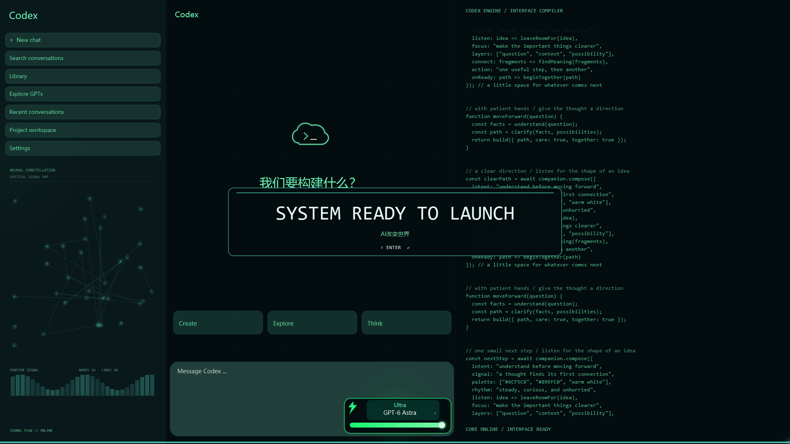

# Codex 启动动画 · AI改变世界

为 Windows 版 Codex 加上约 15 秒的绿色启动动画：标志由慢到快旋转，36 格光环逐格点亮，模型卡、代码流和界面逐步展开。



**[下载安装程序](https://github.com/chenrancr9527-bit/codex-startup-animation/releases/latest/download/CodexStartupSetup.exe)** · [查看发布版本](https://github.com/chenrancr9527-bit/codex-startup-animation/releases) · [观看预览视频](preview.mp4)

## 安装

1. 在 Windows 10/11 **64 位**电脑上先安装 Windows 版 Codex（MSIX / Microsoft Store 安装版本）。
2. 从 Releases 下载 `CodexStartupSetup.exe`，双击运行，点击「安装」。
3. 以后使用桌面或开始菜单中的 **Codex · 启动动画** 打开 Codex。

安装在当前用户的 `%LOCALAPPDATA%\Programs\CodexStartupAnimation`，无需管理员权限。安装程序自动识别 Codex 应用标识，不需要手改源码或路径。原有 Codex 快捷方式继续保留。

也可以下载 `CodexStartupAnimation-1.0.0.zip`，解压后双击里面的安装程序。

这是社区制作的启动器，安装包没有数字签名，Windows 可能提示未知发布者。源码和本地构建脚本均在这个仓库，发布版本附有 SHA-256 校验值。

## 播放与加载

- 前约 5 秒：桌面上显示绿色旋转标志与逐格光环。
- 不透明全屏画面完成第一帧绘制后：启动 Codex，让其加载页面留在动画后面。
- 动画结束：Codex 窗口已就绪则自动进入，否则继续显示绿色等待画面，准备好后再进入。

窗口就绪依据是匹配 Codex 安装包的主窗口正常显示，并连续三次能响应 Windows 消息。登录、网络连接和聊天服务仍由 Codex 自身处理。

模型名称、进度条、节点图与代码流是视觉动画，不表示真实模型下载或真实服务初始化进度。动画本身离线播放，启动器不读取聊天、不修改 Codex 安装包，也不注册开机自启动。动画只从本项目的快捷方式播放。

当前版本覆盖主显示器；原来固定在任务栏的官方 Codex 图标不会自动替换。可以将新的 **Codex · 启动动画** 快捷方式固定到任务栏。

## 操作与设置

`Esc` / `Enter` / 空格可以跳过动画。窗口尚未就绪时仍会等待，等待期间按 `Esc` 可关闭开场。`M` 停止本次启动音效。画面中不会显示静音或 Esc 提示文字。

安装目录中的 `启动设置.ini`：

```ini
Duration=15
Sound=true
AppUserModelId=由安装程序自动检测并填写
```

`Duration` 范围为 5–20 秒，`Sound=false` 关闭音效。升级会保留时长和声音设置，并重新检测 Codex 标识。

`只看动画.exe` 用来单独预览，播放后退出，不启动 Codex。官方图标由安装程序从用户自己已安装的 Codex 中读取；若资源格式改变，会使用本项目原创的终端云图标。

## 卸载

在 Windows 设置的「已安装的应用」中卸载 **Codex 启动动画**，或者运行安装目录里的 `Uninstall.exe`。卸载移除本项目的程序、设置及所属快捷方式，Codex 应用与聊天数据会保留。自己额外放进安装目录的文件不会被清理。

## 从源码构建

在 Windows PowerShell 5.1 或 PowerShell 7 中运行：

```powershell
powershell -NoProfile -File .\build.ps1
powershell -NoProfile -File .\test.ps1
```

系统自带 .NET Framework 4.8 和 C# 编译器即可；无需 Node、Python、npm 或额外构建软件。结果位于 `dist/`：

- `CodexStartupSetup.exe`：带完整运行文件的一体式安装程序。
- `CodexStartupAnimation-1.0.0.zip`：分享包。
- `SHA256SUMS.txt`：发布文件校验值。
- `app/`：构建后的动画程序。

`Install.ps1` 与 `Uninstall.ps1` 是安装/卸载程序的可选脚本入口。

验证包含 Codex 自动发现、安装文件与快捷方式、卸载登记、升级保留设置、卸载仅清理所属文件、路径越界拒绝，以及动画的后台启动/等待路径。真实应用验证使用已有会话，慢启动路径使用独立测试窗口；没有退出真实 Codex 来测试冷启动。

## 许可与说明

本项目的代码和原创资源使用 MIT 许可。OpenAI、Codex 等名称及标志属于其权利人；本项目与 OpenAI 无官方关联。发布包不包含 Codex 软件或提取出的官方图标，图标在安装时从本机 Codex 安装目录读取。

预览中显示的品牌标志不适用本项目的 MIT 授权。参考录屏和个人桌面录屏没有包含在仓库中。
